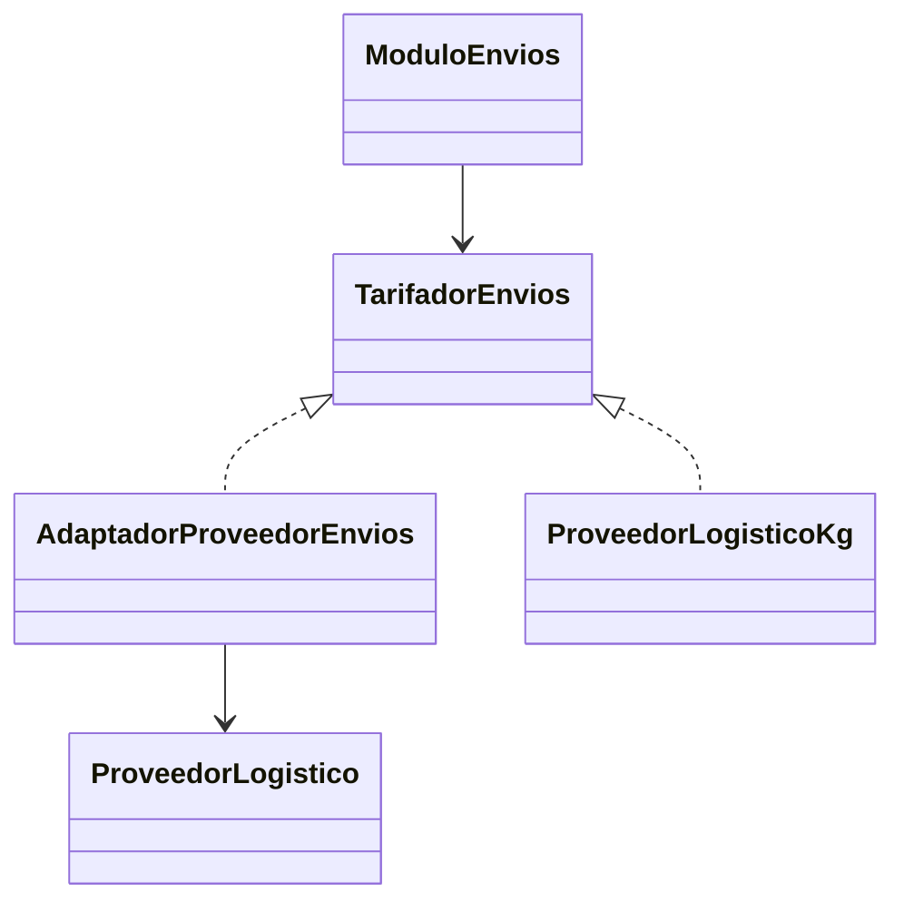
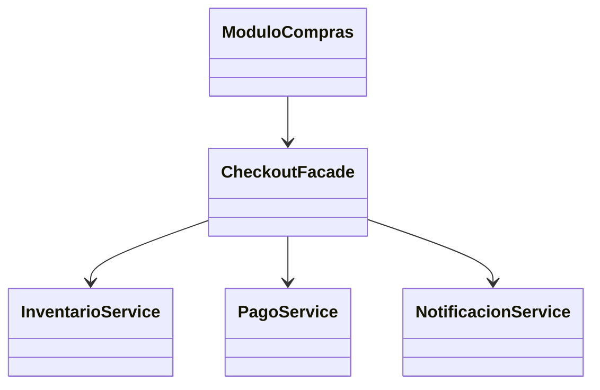
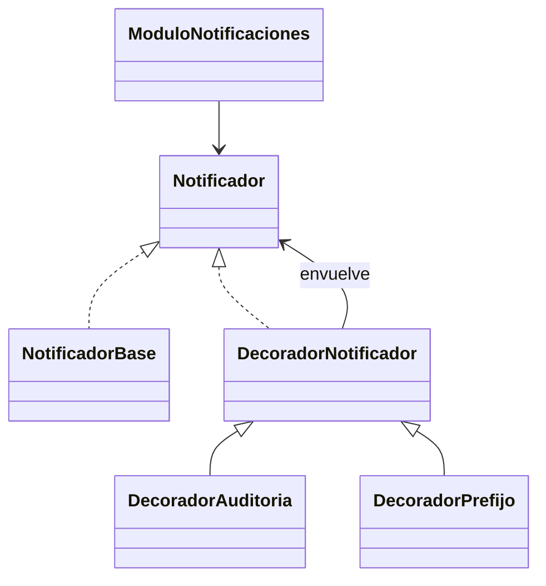
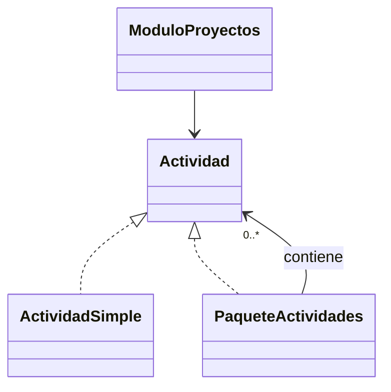
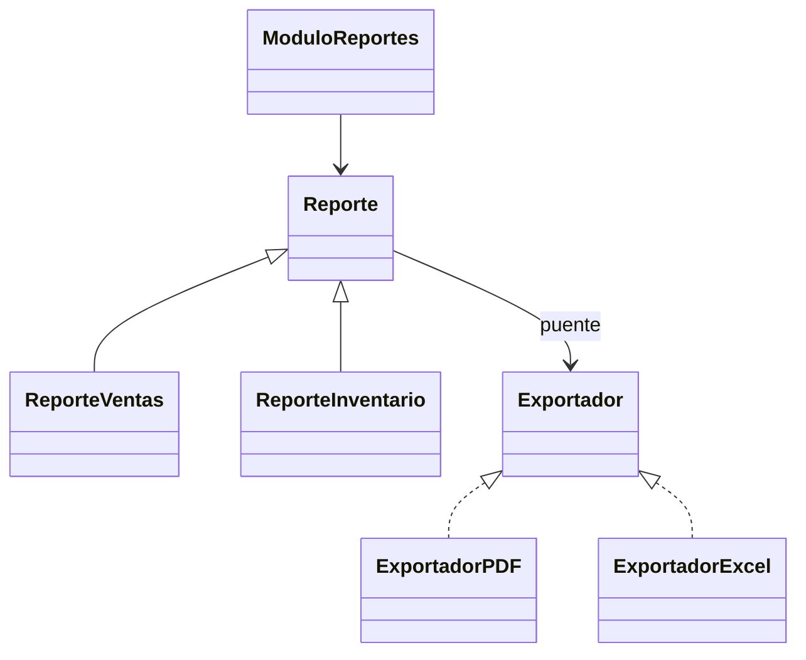
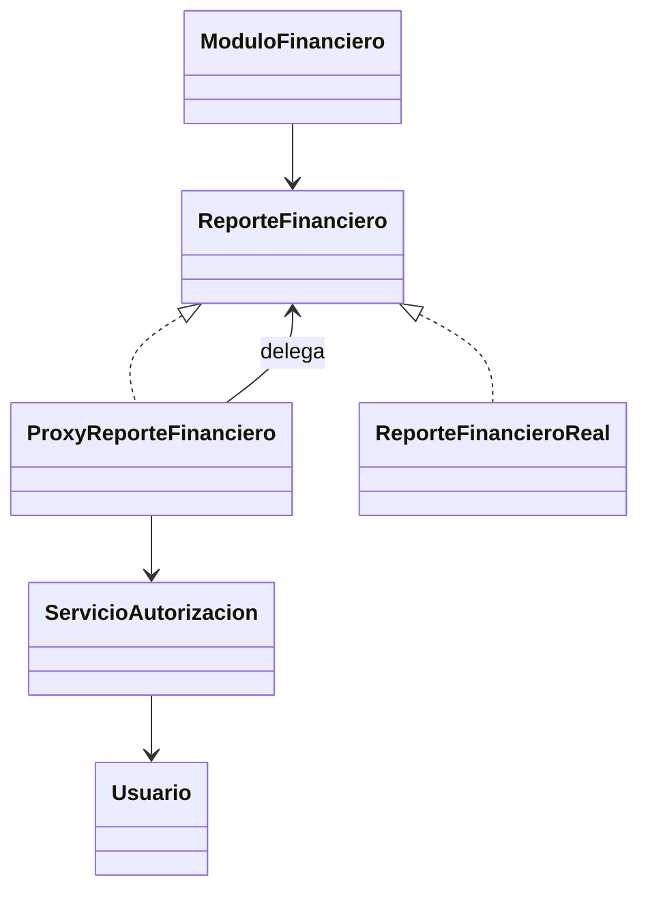
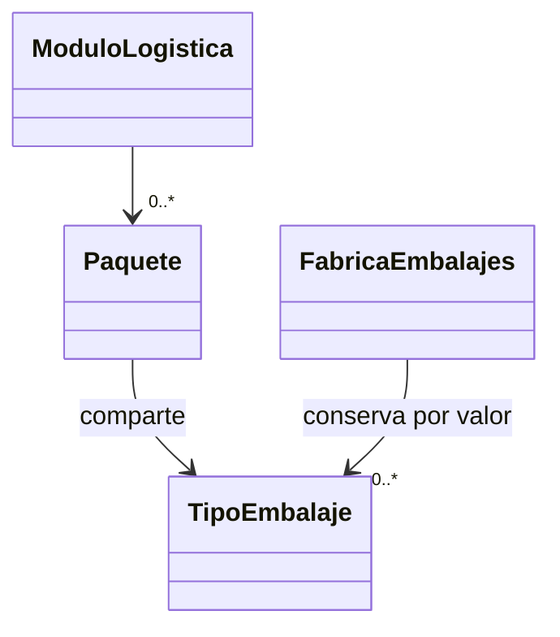

# Sesión 13 · Patrones estructurales

Aprende a reconocer qué problema resuelve cada patrón y a seguir la delegación entre objetos. Los siete demos son independientes y siguen el orden de la explicación.

## Antes de ejecutar

Usa JDK 17 o 21 e IntelliJ IDEA. Abre el Main indicado y selecciona **Run → nombre del Main**. Conserva los paquetes y sus archivos juntos; demo y labs son raíces de código fuente, no las carpetas con guiones del módulo. Todos los ejemplos trabajan en memoria y consola.

## Orden de explicación

| Demo | Patrón | Ejemplo |
| --- | --- | --- |
| 00 | Adapter | [Integrar tarifas en gramos](demo/s13demo00/S13Demo00AdapterMain.java) |
| 01 | Facade | [Confirmar una compra](demo/s13demo01/S13Demo01FacadeMain.java) |
| 02 | Decorator | [Combinar notificaciones](demo/s13demo02/S13Demo02DecoratorMain.java) |
| 03 | Composite | [Sumar actividades anidadas](demo/s13demo03/S13Demo03CompositeMain.java) |
| 04 | Bridge | [Combinar reportes y formatos](demo/s13demo04/S13Demo04BridgeMain.java) |
| 05 | Proxy | [Controlar consultas](demo/s13demo05/S13Demo05ProxyMain.java) |
| 06 | Flyweight | [Compartir embalajes](demo/s13demo06/S13Demo06FlyweightMain.java) |

## Laboratorios · 60 minutos

El código está completo. Tu tarea es predecir, ejecutar, seguir el flujo y realizar las variaciones indicadas en cada guía.

| Lab | Actividad | Tiempo |
| --- | --- | --- |
| 00 | [Adapter: duración de citas](labs/s13lab00/README.md) | 12 min |
| 01 | [Facade: préstamo bibliotecario](labs/s13lab01/README.md) | 15 min |
| 02 | [Decorator: empaque de pedidos](labs/s13lab02/README.md) | 13 min |
| 03 | [Composite: ruta formativa](labs/s13lab03/README.md) | 15 min |
| Cierre | Comparar resultados y explicar qué problema resuelve cada patrón | 5 min |

Los demos acompañan la explicación; esta hora corresponde a los labs y al cierre. Completa en casa lo que no alcances y trae tus resultados a la siguiente clase.

## Demo 00 · Adapter · Integrar tarifas en gramos

**Problema:** el módulo espera kg y el proveedor ofrece gramos. Convertir dentro de cada cliente duplicaría la integración. Adapter concentra esa traducción; un proveedor que ya cumple el contrato no necesita adaptador.

Tarifas ficticias: proveedor en gramos = 5000 + 2 × gramos; proveedor en kg = 6000 + gramos, en pesos enteros. Se admiten de 1 a 100000 gramos (0.001 a 100 kg), sin fracciones de gramo. BigDecimal.valueOf convierte la representación decimal del peso y longValueExact evita truncamientos. No estamos comparando precios reales.

**Orden de lectura:** Lee TarifadorEnvios → ProveedorLogistico → AdaptadorProveedorEnvios → ProveedorLogisticoKg → ModuloEnvios → Main. El cliente conoce el contrato en kg; el adaptador traduce a gramos y delega.



1. Abre [S13Demo00AdapterMain.java](demo/s13demo00/S13Demo00AdapterMain.java) y predice qué clases ejecutarán cada operación.
2. Ejecuta el Main y compara la consola con esta salida.
3. Coloca un breakpoint en calcularTarifa del adaptador; ejecuta Debug y usa Step Into para seguir la delegación.

```text
Proveedor recibe: 1000 g
Tarifa: 7000 pesos
Proveedor recibe: 2500 g
Tarifa: 10000 pesos
Proveedor kg: 8500 pesos
Peso rechazado: 0.0
Peso rechazado: -1.0
Peso rechazado: NaN
Peso rechazado: Infinity
Peso rechazado: 5.0E-4
```

**Cuándo evitarlo:** Si puedes unificar los contratos directamente, la traducción adicional podría sobrar.

## Demo 01 · Facade · Confirmar una compra

**Problema:** repetir en cada cliente reserva, pago y aviso facilita errores de orden. La fachada ofrece una operación y coordina esos servicios.

Cada escenario usa servicios nuevos y compra una unidad. Si falla la disponibilidad no se intenta cobrar; si el pago es rechazado se restituye el stock y no se avisa. El boolean del pago simula la respuesta de un proveedor, no una autorización real. Es una compensación local en memoria, no una transacción distribuida.

**Orden de lectura:** Lee InventarioService, PagoService y NotificacionService → CheckoutFacade → ModuloCompras → Main. La fachada coordina; las reglas permanecen en cada servicio.



1. Abre [S13Demo01FacadeMain.java](demo/s13demo01/S13Demo01FacadeMain.java) y predice qué clases ejecutarán cada operación.
2. Ejecuta el Main y compara la consola con esta salida.
3. Coloca un breakpoint en confirmarPedido; ejecuta Debug y usa Step Into para seguir la delegación.

```text
Compra confirmada
Stock=0 pagos=1 avisos=1
Sin existencias
Stock=0 pagos=0 avisos=0
Pago rechazado; reserva liberada
Stock=1 pagos=1 avisos=0
```

**Cuándo evitarlo:** Si solo se necesita una llamada sencilla, una fachada adicional puede no aportar claridad.

## Demo 02 · Decorator · Combinar notificaciones

**Problema:** crear una subclase por cada combinación de prefijo y auditoría multiplica clases. Los decoradores permiten componer capacidades con objetos.

El decorador exterior recibe primero la llamada: auditoría exterior registra Hola; prefijo exterior hace que la auditoría vea [Campus] Hola. Ambos envíos finales tienen prefijo. La clase abstracta usa herencia para compartir delegación; las combinaciones se forman por composición.

**Orden de lectura:** Lee Notificador → NotificadorBase → DecoradorNotificador → DecoradorPrefijo y DecoradorAuditoria → ModuloNotificaciones → Main. Cada envoltorio conserva el contrato.



1. Abre [S13Demo02DecoratorMain.java](demo/s13demo02/S13Demo02DecoratorMain.java) y predice qué clases ejecutarán cada operación.
2. Ejecuta el Main y compara la consola con esta salida.
3. Coloca un breakpoint en enviar de DecoradorAuditoria; ejecuta Debug y usa Step Into para seguir la delegación.

```text
ENVIO: Hola
ENVIO: [Campus] Hola
AUDITORIA: Hola
ENVIO: Hola
Auditoria exterior:
AUDITORIA: Hola
ENVIO: [Campus] Hola
Prefijo exterior:
AUDITORIA: [Campus] Hola
ENVIO: [Campus] Hola
```

**Cuándo evitarlo:** Para un comportamiento fijo sin opciones combinables, una implementación directa puede bastar.

## Demo 03 · Composite · Sumar actividades anidadas

**Problema:** el cliente tendría que distinguir entre actividad individual y grupo y recorrer cada nivel por su cuenta. Composite expone calcularCosto para ambos.

Una actividad cuesta entre 0 y 1000000 pesos. Se usa long y Math.addExact para detectar desbordamientos al sumar. El compuesto guarda su lista privada y rechaza null y ciclos directos o indirectos. Cada incorporación cuenta una vez: agregar dos veces una misma hoja duplica su costo; no se deduplica automáticamente.

**Orden de lectura:** Lee Actividad → ActividadSimple → PaqueteActividades → ModuloProyectos → Main. Una hoja devuelve su costo; el compuesto suma los costos de sus hijos.



1. Abre [S13Demo03CompositeMain.java](demo/s13demo03/S13Demo03CompositeMain.java) y predice qué clases ejecutarán cada operación.
2. Ejecuta el Main y compara la consola con esta salida.
3. Coloca un breakpoint en calcularCosto del compuesto; ejecuta Debug y usa Step Into para seguir la delegación.

```text
Costo: 10000 pesos
Costo: 0 pesos
Costo: 30000 pesos
Ciclo rechazado
```

**Cuándo evitarlo:** Para una lista plana sin grupos anidados, un ciclo puede resultar más simple.

## Demo 04 · Bridge · Combinar reportes y formatos

**Problema:** VentasPDF, VentasExcel, InventarioPDF e InventarioExcel acoplan dos dimensiones. Bridge mantiene por separado tipos de reporte y exportadores.

Los cuatro resultados son **simulaciones en consola**: no se crean PDF, Excel ni archivos. Agregar un tipo de reporte no exige cambiar los exportadores; agregar un formato no exige modificar las clases de reporte.

**Orden de lectura:** Lee Exportador y sus dos implementaciones → Reporte → ReporteVentas y ReporteInventario → ModuloReportes → Main. Reporte mantiene el puente mediante su referencia Exportador.



1. Abre [S13Demo04BridgeMain.java](demo/s13demo04/S13Demo04BridgeMain.java) y predice qué clases ejecutarán cada operación.
2. Ejecuta el Main y compara la consola con esta salida.
3. Coloca un breakpoint en generar de ReporteVentas; ejecuta Debug y usa Step Into para seguir la delegación.

```text
PDF simulado: Ventas: 3 pedidos
Excel simulado: Ventas: 3 pedidos
PDF simulado: Inventario: 8 unidades
Excel simulado: Inventario: 8 unidades
```

**Cuándo evitarlo:** Si no existen dos dimensiones que cambien independientemente, separar dos jerarquías puede ser innecesario.

## Demo 05 · Proxy · Controlar consultas

**Problema:** verificar permisos dentro de cada cliente repite controles y puede dejar rutas sin revisar. El proxy comprueba antes de delegar.

Ana tiene permiso ficticio y Luis no. La consulta denegada no aumenta el contador real. Esta demostración no implementa un sistema de seguridad: acceder directamente al objeto real omitiría el proxy, y el permiso debe provenir de una fuente confiable en una aplicación real.

**Orden de lectura:** Lee Usuario y ReporteFinanciero → ReporteFinancieroReal → ServicioAutorizacion → ProxyReporteFinanciero → ModuloFinanciero → Main. Proxy y objeto real cumplen la misma interfaz.



1. Abre [S13Demo05ProxyMain.java](demo/s13demo05/S13Demo05ProxyMain.java) y predice qué clases ejecutarán cada operación.
2. Ejecuta el Main y compara la consola con esta salida.
3. Coloca un breakpoint en consultarReporte del proxy; ejecuta Debug y usa Step Into para seguir la delegación.

```text
Reporte ficticio para Ana
Acceso denegado
Consultas reales: 1
```

**Cuándo evitarlo:** Si no hay necesidad de mediar el acceso, el cliente puede usar directamente la implementación.

## Demo 06 · Flyweight · Compartir embalajes

**Problema:** repetir características idénticas en cada paquete mantiene objetos equivalentes innecesarios. La fábrica conserva una instancia por combinación completa de características.

TipoEmbalaje es inmutable y sirve como clave por valor (equals/hashCode). Una búsqueda construye una clave temporal; lo que se reduce son las instancias **retenidas**, no todas las asignaciones temporales. El ejemplo demuestra identidad compartida y cantidad de tipos, no mide bytes ni rendimiento. La fábrica es local, monohilo y sin política de expulsión.

**Orden de lectura:** Lee TipoEmbalaje → FabricaEmbalajes → Paquete → ModuloLogistica → Main. Tipo, material y dimensiones se comparten; código, destinatario y peso pertenecen a cada paquete.



1. Abre [S13Demo06FlyweightMain.java](demo/s13demo06/S13Demo06FlyweightMain.java) y predice qué clases ejecutarán cada operación.
2. Ejecuta el Main y compara la consola con esta salida.
3. Coloca un breakpoint en obtenerEmbalaje; ejecuta Debug y usa Step Into para seguir la delegación.

```text
P1 para Ana (1.0 kg): Caja / Carton / 20x20x20
P2 para Luis (2.0 kg): Caja / Carton / 20x20x20
Paquetes distintos: true
Embalaje compartido: true
Paquetes: 3
Tipos retenidos: 2
```

**Cuándo evitarlo:** Si hay pocos objetos o sus características casi nunca se repiten, la fábrica y sus claves pueden costar más de lo que ahorran.

