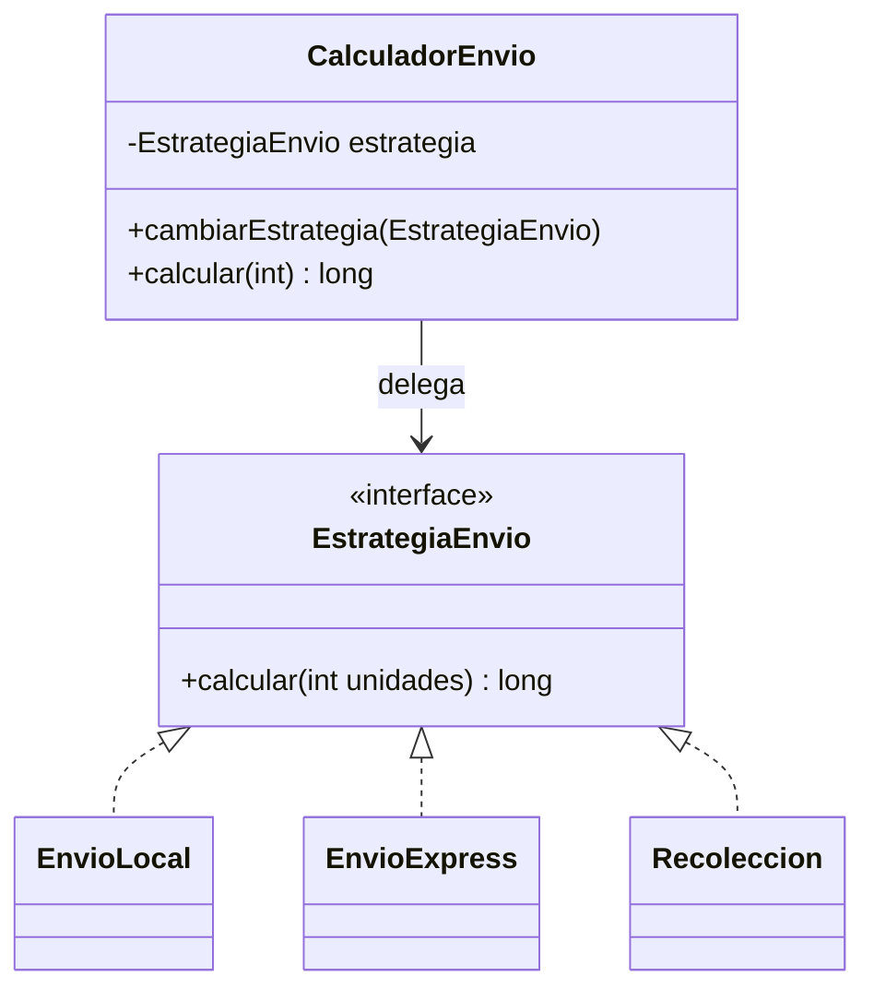
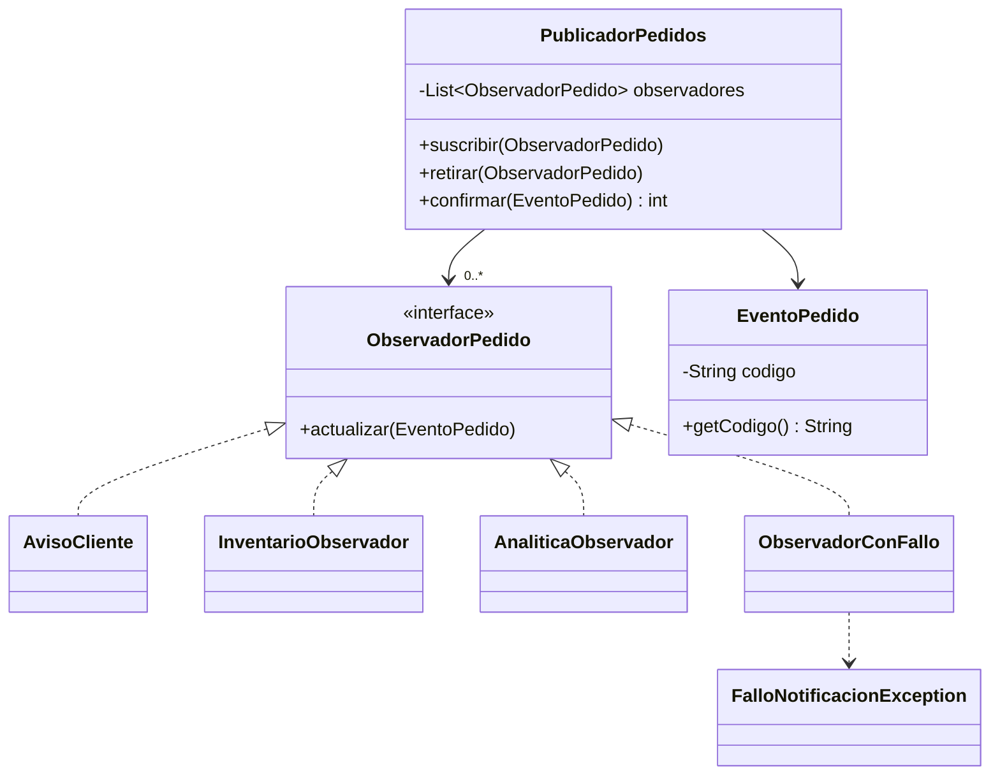
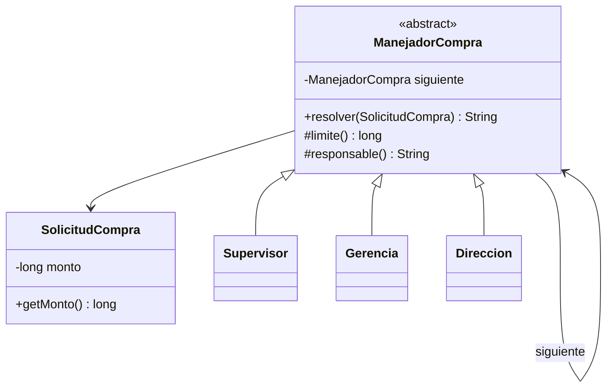
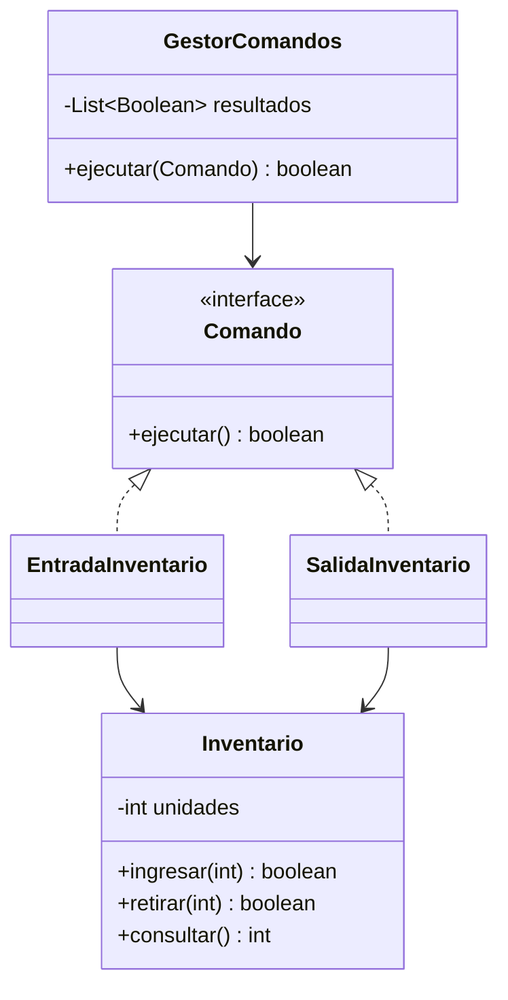
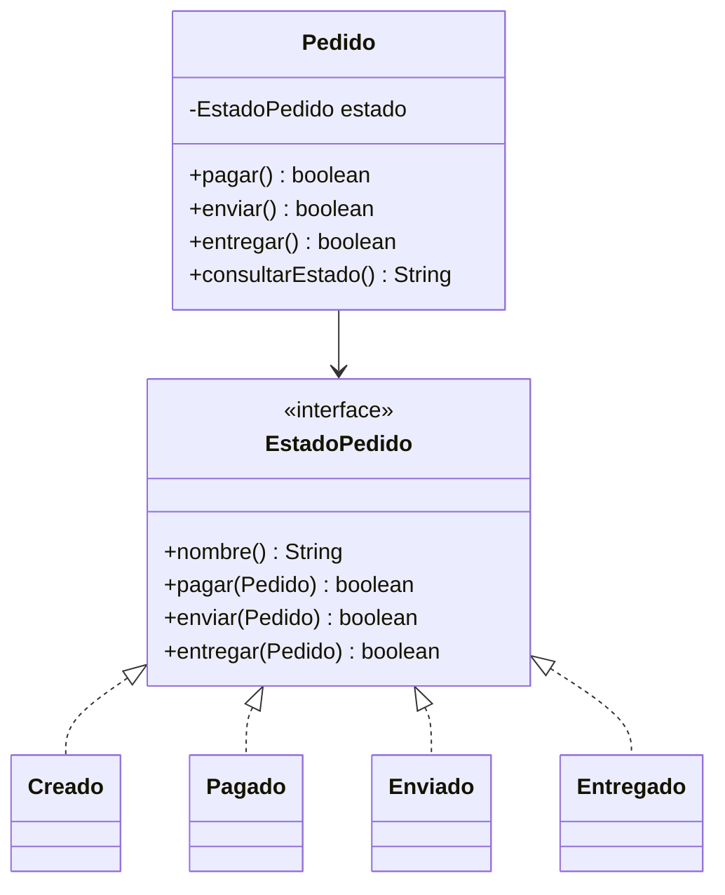
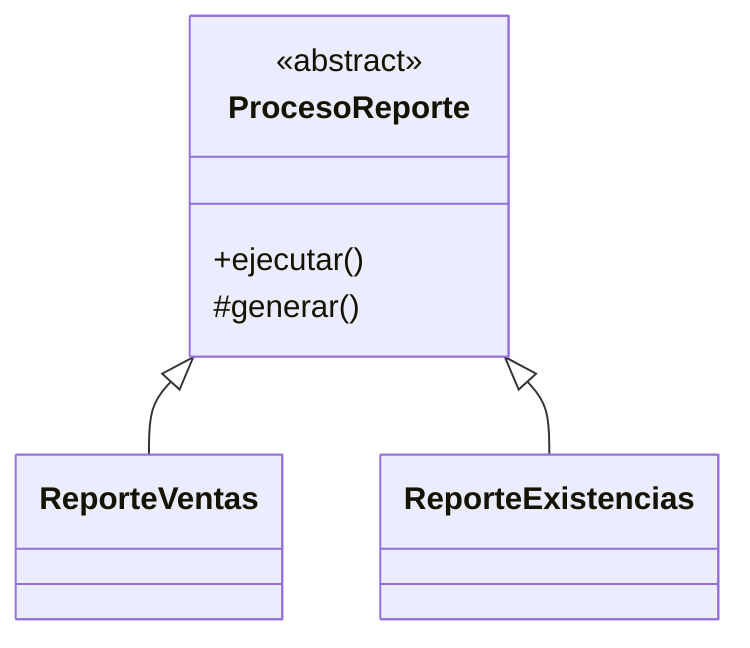
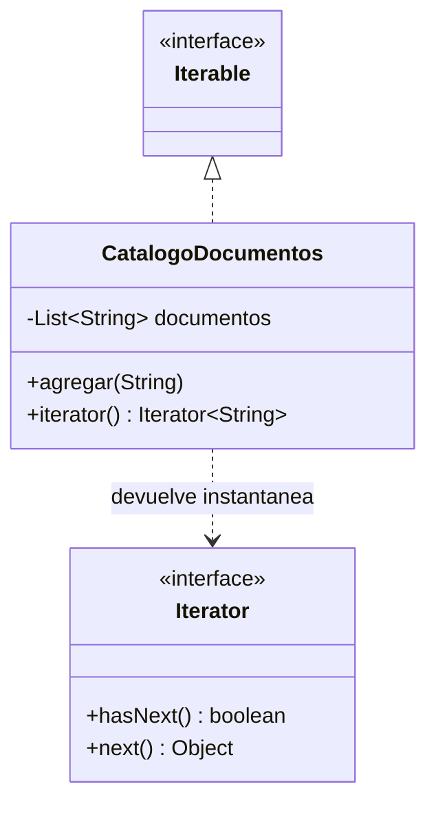
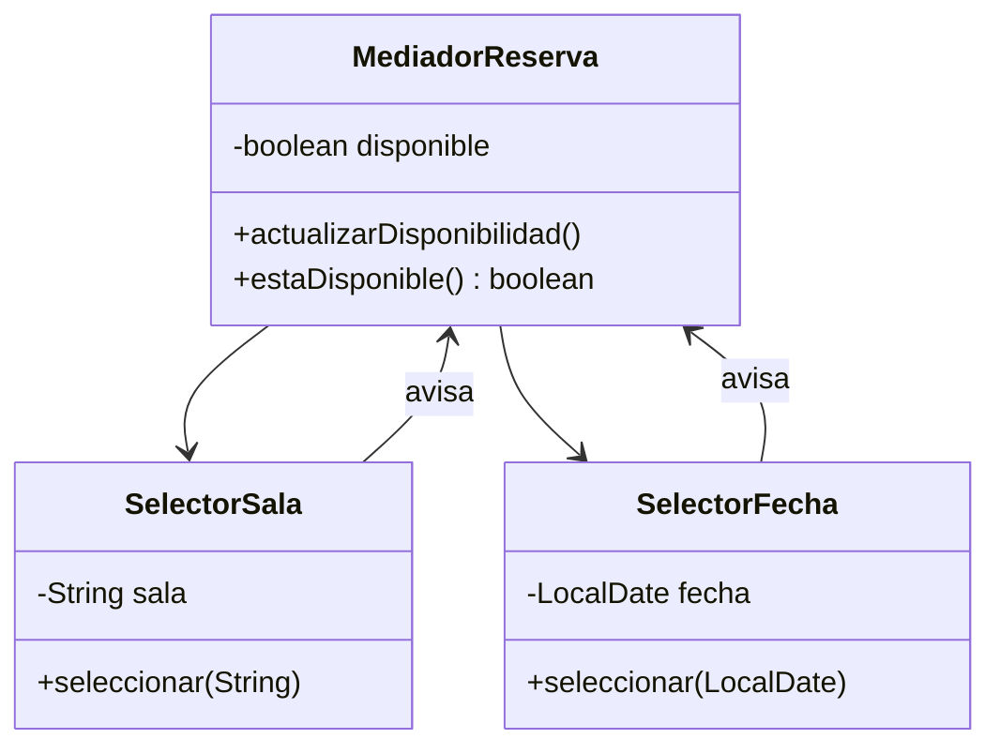
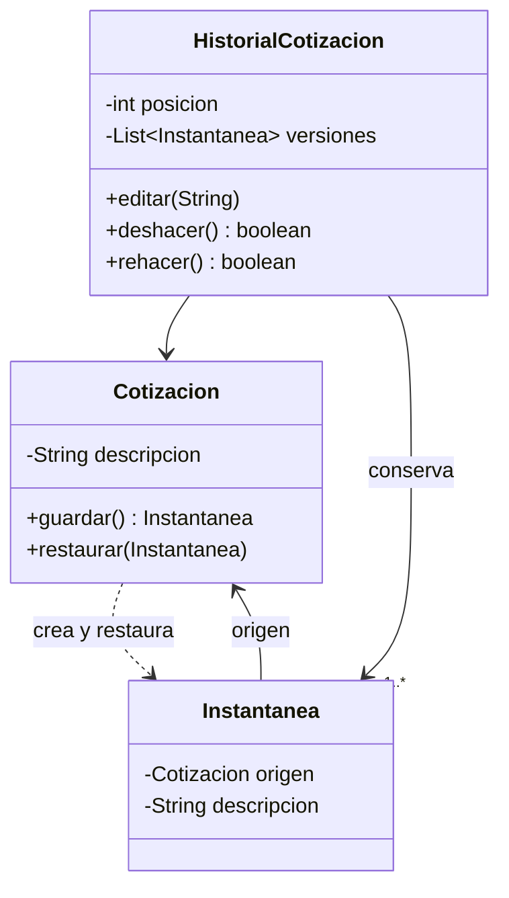
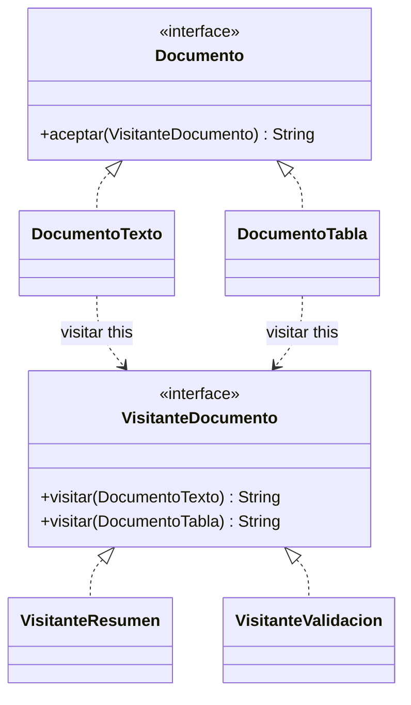

# Sesión 14 · Patrones de comportamiento

Aprende a identificar quién decide, quién actúa y cómo colaboran los objetos. Cada demo es independiente. Los primeros cinco acompañan la explicación principal; los otros cinco son ejemplos breves de reconocimiento.

## Ejecutar en IntelliJ IDEA

Usa JDK 17 o 21. Abre el Main indicado y selecciona **Run → nombre del Main**. Conserva cada paquete con sus clases. Las carpetas demo y labs son raíces de código fuente; las carpetas organizativas con guiones no son paquetes Java. Todo se ejecuta en consola y memoria.

## Orden de los demos

| Demo | Patrón | Caso |
| --- | --- | --- |
| 00 | Strategy | [Tarifas de envío](demo/s14demo00/S14Demo00StrategyMain.java) |
| 01 | Observer | [Pedido confirmado](demo/s14demo01/S14Demo01ObserverMain.java) |
| 02 | Chain of Responsibility | [Aprobación de compras](demo/s14demo02/S14Demo02ChainMain.java) |
| 03 | Command | [Operaciones de inventario](demo/s14demo03/S14Demo03CommandMain.java) |
| 04 | State | [Ciclo de pedido](demo/s14demo04/S14Demo04StateMain.java) |
| 05 | Template Method | [Proceso fijo de reportes](demo/s14demo05/S14Demo05TemplateMethodMain.java) |
| 06 | Iterator | [Catálogo de documentos](demo/s14demo06/S14Demo06IteratorMain.java) |
| 07 | Mediator | [Formulario de reserva](demo/s14demo07/S14Demo07MediatorMain.java) |
| 08 | Memento | [Versiones de cotización](demo/s14demo08/S14Demo08MementoMain.java) |
| 09 | Visitor | [Operaciones sobre documentos](demo/s14demo09/S14Demo09VisitorMain.java) |

## Laboratorios · 60 minutos

El código está completo. Sigue las guías para predecir, ejecutar, depurar y realizar pequeños cambios; no necesitas escribir cinco sistemas desde cero.

| Lab | Actividad | Tiempo |
| --- | --- | --- |
| 00 | [Strategy: descuentos](labs/s14lab00/README.md) | 10 min |
| 01 | [Observer: cupos académicos](labs/s14lab01/README.md) | 12 min |
| 02 | [Chain: mesa de ayuda](labs/s14lab02/README.md) | 10 min |
| 03 | [Command: préstamos](labs/s14lab03/README.md) | 11 min |
| 04 | [State: reserva de habitación](labs/s14lab04/README.md) | 12 min |
| Cierre | Comparar Strategy/State y Command/llamada directa | 5 min |

Los demos se realizan durante la explicación. Completa en casa lo que quede pendiente y trae los resultados a la próxima clase. Esta sesión cubre diez patrones; no pretende agotar el catálogo de comportamiento.

## Demo 00 · Strategy · Tarifas de envío

Una condición por modalidad mezcla cálculos con el contexto. Strategy permite sustituir la regla mediante un contrato.

**Orden de lectura:** EstrategiaEnvio → EnvioLocal, EnvioExpress y Recoleccion → CalculadorEnvio → Main.

Tarifas ficticias en pesos: local=5000+1000×unidades, exprés=10000+2000×unidades, recolección=0. Unidades entre 1 y 100. El cliente elige y el contexto delega.



1. Abre [S14Demo00StrategyMain.java](demo/s14demo00/S14Demo00StrategyMain.java). Predice el resultado antes de ejecutarlo.
2. Ejecuta el Main y compara con la salida siguiente.
3. En Debug, coloca un breakpoint en calcular de CalculadorEnvio; usa Step Into para seguir quién recibe la llamada y quién realiza la operación.

```text
Local: 8000
Express: 16000
Recoleccion: 0
```

**Cuándo evitarlo:** Si hay una única regla estable, una clase directa puede bastar.

## Demo 01 · Observer · Pedido confirmado

Una confirmación interesa a varios servicios. Llamarlos directamente desde el pedido acopla cada nuevo interesado; Observer permite suscripción.

**Orden de lectura:** EventoPedido y ObservadorPedido → observadores concretos → PublicadorPedidos → Main.

Publicación síncrona en memoria y por orden de suscripción. Una misma instancia no se duplica. Se recorre una copia: las altas/bajas durante un aviso afectan la próxima publicación. Solo se captura FalloNotificacionException; una entrega fallida no cuenta como éxito y no revierte la confirmación. Inventario es una reacción simulada, sin garantías transaccionales.



1. Abre [S14Demo01ObserverMain.java](demo/s14demo01/S14Demo01ObserverMain.java). Predice el resultado antes de ejecutarlo.
2. Ejecuta el Main y compara con la salida siguiente.
3. En Debug, coloca un breakpoint en confirmar de PublicadorPedidos; usa Step Into para seguir quién recibe la llamada y quién realiza la operación.

```text
Aviso: P1
Fallo de entrega: Canal simulado no disponible
Inventario simulado: P1
Analitica: P1
Entregas: 3
Fallo de entrega: Canal simulado no disponible
Inventario simulado: P2
Analitica: P2
Entregas tras baja: 2
Sin suscriptores: 0
```

**Cuándo evitarlo:** Una llamada directa es más clara si existe un único colaborador fijo.

## Demo 02 · Chain · Aprobación de compras

El solicitante no debe decidir qué autoridad aprueba. La cadena entrega la solicitud al primer responsable con capacidad.

**Orden de lectura:** SolicitudCompra → ManejadorCompra → Supervisor, Gerencia y Direccion → Main.

Montos positivos en pesos enteros. Límites inclusivos: 100000, 500000 y 1000000. Si nadie resuelve, devuelve Rechazada. El siguiente se fija al construir y la cadena se arma sin ciclos. Esta variante se detiene en el primer responsable; no ejecuta todas las validaciones.



1. Abre [S14Demo02ChainMain.java](demo/s14demo02/S14Demo02ChainMain.java). Predice el resultado antes de ejecutarlo.
2. Ejecuta el Main y compara con la salida siguiente.
3. En Debug, coloca un breakpoint en resolver de ManejadorCompra; usa Step Into para seguir quién recibe la llamada y quién realiza la operación.

```text
1: Supervisor
100000: Supervisor
100001: Gerencia
500000: Gerencia
500001: Direccion
1000000: Direccion
1000001: Rechazada
```

**Cuándo evitarlo:** Para una regla pequeña y fija, condiciones sencillas pueden bastar.

## Demo 03 · Command · Operaciones de inventario

Un invocador que conoce cada detalle del inventario es difícil de extender. Command encapsula receptor y parámetros de cada acción.

**Orden de lectura:** Inventario → Comando → EntradaInventario y SalidaInventario → GestorComandos → Main.

Stock entre 0 y 100. La regla se comprueba al ejecutar. Cada intento registra true o false; un false no modifica existencias. Invocar un comando nuevamente vuelve a intentarlo: no hay ejecución única, cola persistente ni undo automático.



1. Abre [S14Demo03CommandMain.java](demo/s14demo03/S14Demo03CommandMain.java). Predice el resultado antes de ejecutarlo.
2. Ejecuta el Main y compara con la salida siguiente.
3. En Debug, coloca un breakpoint en ejecutar de GestorComandos; usa Step Into para seguir quién recibe la llamada y quién realiza la operación.

```text
Entrada: true
Salida: true
Salida excesiva: false
Stock: 6
Resultados: [true, true, false]
```

**Cuándo evitarlo:** Si solo necesitas una llamada inmediata sin registrar ni parametrizar la operación, puedes llamar al receptor.

## Demo 04 · State · Ciclo de pedido

Las operaciones permitidas dependen de la situación del pedido. State delega esas decisiones en objetos estado.

**Orden de lectura:** EstadoPedido → Creado, Pagado, Enviado y Entregado → Pedido → Main.

Solo se permite pagar desde Creado, enviar desde Pagado y entregar desde Enviado. Las demás acciones devuelven false sin cambiar el estado. El cambio interno tiene acceso de paquete; un cliente externo no asigna estados arbitrarios.



1. Abre [S14Demo04StateMain.java](demo/s14demo04/S14Demo04StateMain.java). Predice el resultado antes de ejecutarlo.
2. Ejecuta el Main y compara con la salida siguiente.
3. En Debug, coloca un breakpoint en enviar de Pedido; usa Step Into para seguir quién recibe la llamada y quién realiza la operación.

```text
Inicial: Creado
Enviar antes de pagar: false
Estado: Creado
Pagar: true
Enviar: true
Entregar: true
Entregar otra vez: false
Final: Entregado
```

**Cuándo evitarlo:** Para una etiqueta con pocas reglas, enum puede ser suficiente. Strategy cambia un algoritmo; State controla acciones según la situación.

## Demo 05 · TemplateMethod · Proceso fijo de reportes

Los reportes comparten pasos y varían una etapa. Template Method fija el proceso en la clase base.

**Orden de lectura:** ProcesoReporte → ReporteVentas y ReporteExistencias → Main.

ejecutar es final; generar es el paso protegido y abstracto. No se generan archivos. El orden común permanece invariable.



1. Abre [S14Demo05TemplateMethodMain.java](demo/s14demo05/S14Demo05TemplateMethodMain.java). Predice el resultado antes de ejecutarlo.
2. Ejecuta el Main y compara con la salida siguiente.
3. En Debug, coloca un breakpoint en ejecutar de ProcesoReporte; usa Step Into para seguir quién recibe la llamada y quién realiza la operación.

```text
Preparar datos
Validar datos
Generar ventas
Entregar reporte simulado
Preparar datos
Validar datos
Generar existencias
Entregar reporte simulado
```

**Cuándo evitarlo:** Si necesitas combinar pasos libremente, valora composición o Strategy.

## Demo 06 · Iterator · Catálogo de documentos

Recorrer sin conocer el almacenamiento evita acoplar el cliente a índices y listas internas.

**Orden de lectura:** CatalogoDocumentos → Iterator estándar → Main.

El catálogo implementa Iterable<String> y devuelve un iterador sobre una copia inmutable. El recorrido es una instantánea y remove no está permitido. Usa hasNext antes de next. No modificar estructuralmente una colección desde for-each.



1. Abre [S14Demo06IteratorMain.java](demo/s14demo06/S14Demo06IteratorMain.java). Predice el resultado antes de ejecutarlo.
2. Ejecuta el Main y compara con la salida siguiente.
3. En Debug, coloca un breakpoint en iterator de CatalogoDocumentos; usa Step Into para seguir quién recibe la llamada y quién realiza la operación.

```text
Vacio: true
Un elemento: Guia
for-each: Guia
for-each: Manual
Iterator: Guia
Iterator: Manual
```

**Cuándo evitarlo:** Para una lista habitual, usa su iterador estándar; no construyas uno propio sin necesidad.

## Demo 07 · Mediator · Formulario de reserva

Si los selectores se conocen entre sí, cada nueva dependencia complica el formulario. Mediator concentra la coordinación.

**Orden de lectura:** MediadorReserva → SelectorSala y SelectorFecha → Main.

Simulación de consola: solo sala A y fecha 2026-11-02 están disponibles. Cada selector avisa al mediador; actualizar disponible no genera otro evento. Los selectores no se referencian entre sí.



1. Abre [S14Demo07MediatorMain.java](demo/s14demo07/S14Demo07MediatorMain.java). Predice el resultado antes de ejecutarlo.
2. Ejecuta el Main y compara con la salida siguiente.
3. En Debug, coloca un breakpoint en actualizarDisponibilidad; usa Step Into para seguir quién recibe la llamada y quién realiza la operación.

```text
Solo sala: false
Sala y fecha: true
Cambio de sala: false
```

**Cuándo evitarlo:** Con dos componentes y una regla fija puede bastar una coordinación directa; evita un mediador que absorba todo.

## Demo 08 · Memento · Versiones de cotización

Restaurar una versión exige conservar el estado sin abrir sus detalles al historial. Memento separa instantánea y cuidador.

**Orden de lectura:** Cotizacion y su Instantanea → HistorialCotizacion → Main.

El historial guarda Inicial, luego A y B. El índice retrocede/avanza en undo/redo. Editar C después de volver a A elimina B. El cuidador no lee el contenido de la instantánea; solo Cotizacion restaura y rechaza instantáneas de otro origen. Las ediciones usadas con historial deben pasar por HistorialCotizacion.editar.



1. Abre [S14Demo08MementoMain.java](demo/s14demo08/S14Demo08MementoMain.java). Predice el resultado antes de ejecutarlo.
2. Ejecuta el Main y compara con la salida siguiente.
3. En Debug, coloca un breakpoint en deshacer de HistorialCotizacion; usa Step Into para seguir quién recibe la llamada y quién realiza la operación.

```text
Undo inicial: false
Undo 1: Version A
Undo 2: Inicial
Redo: Version A
Nueva edicion: Version C
Redo descartado: false
```

**Cuándo evitarlo:** Para datos grandes o cambios frecuentes, guardar una copia por edición puede ser costoso; valora otra estrategia.

## Demo 09 · Visitor · Operaciones sobre documentos

Agregar operaciones a clases de documentos estables puede llenarlas de responsabilidades. Visitor separa resumen y validación.

**Orden de lectura:** Documento y VisitanteDocumento → DocumentoTexto y DocumentoTabla → visitantes concretos → Main.

aceptar llama visitar(this) desde cada tipo concreto. Las sobrecargas seleccionan la operación correspondiente al elemento. Añadir una operación crea otro visitante; añadir un tipo de documento exige actualizar el contrato y los visitantes.



1. Abre [S14Demo09VisitorMain.java](demo/s14demo09/S14Demo09VisitorMain.java). Predice el resultado antes de ejecutarlo.
2. Ejecuta el Main y compara con la salida siguiente.
3. En Debug, coloca un breakpoint en aceptar de DocumentoTabla; usa Step Into para seguir quién recibe la llamada y quién realiza la operación.

```text
Texto: 4 caracteres
Texto valido: true
Tabla: 3 filas
Tabla valida: true
```

**Cuándo evitarlo:** Si los tipos cambian mucho o solo hay una operación simple, un método convencional puede resultar más claro.

